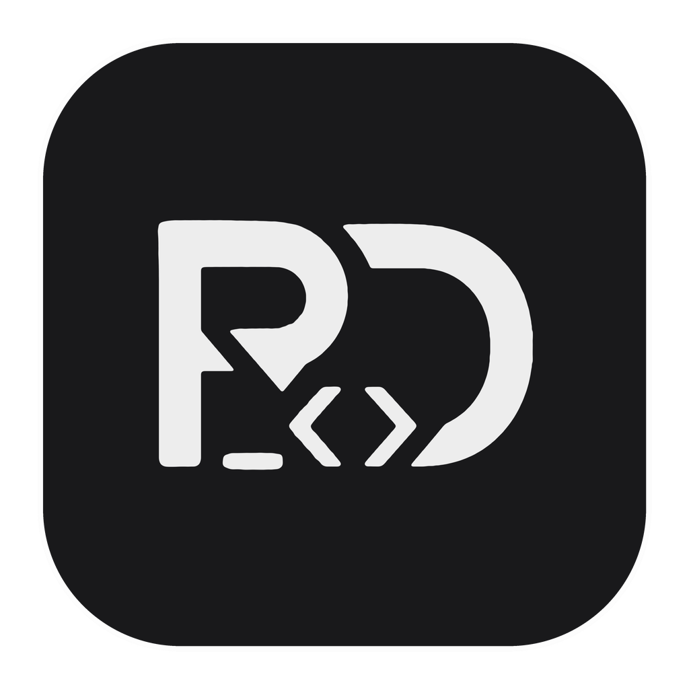

<div align="center">
  

  # RickDev Presence Studio

  Rich Presence personalizada no Discord, sem mexer em código.

  <p>
    
    
  </p>
</div>

---

## O que dá para fazer

- Montar a atividade com textos, imagens, até dois botões e cronômetro, vendo o resultado na pré-visualização
- Alternar textos e imagens sozinhos, cada um no seu intervalo
- Escolher o que aparece ao seu lado na lista de membros: o nome do app, os detalhes ou o estado
- Guardar cinco perfis e trocar entre eles pela janela ou pelo ícone da bandeja
- Mostrar a música ou o vídeo que está tocando no Windows (Spotify, YouTube Music, navegadores e outros players)
- Usar variáveis como `{hora}` e `{música}` nos textos
- Trocar o perfil sozinho quando um programa abre ou num horário
- Ocultar a presence ou trocar de perfil quando você fica ausente
- Atualizar o app com um clique quando sai versão nova

## Download

Baixe o `RickDev Presence Studio.exe` em [Releases](https://github.com/Eu-RickDev/RickDev-presence-studio/releases/latest) e abra. Não precisa instalar.

O portátil leva alguns segundos para abrir, porque se descompacta a cada vez. Ao fechar a janela, ele continua na bandeja; para sair de vez, use **Encerrar** no menu do ícone.

## Como começar

1. No [Discord Developer Portal](https://discord.com/developers/applications), crie uma aplicação em **New Application**. O nome dela é o que aparece como "Jogando ...".
2. Copie o **Application ID** e cole no Studio.
3. Com o Discord aberto, preencha os campos e clique em **Ativar presence**.

Para as imagens, use a chave de um asset enviado em **Rich Presence Assets** no Developer Portal ou um link `https://` direto para a imagem. Sem imagem, aparece o ícone da aplicação.

Com **Alternar imagens** ligado, preencha as variações e escolha o intervalo. Um campo vazio mantém a imagem principal, então dá para trocar só a grande ou só a pequena.

Em **Na lista de membros**, escolha o que aparece ao lado do seu nome: o nome do app (padrão), os detalhes ou o estado. Com Detalhes, aparece "Ouvindo Copines" em vez de "Ouvindo Spotify".

## Variáveis

Clique na seta ao lado de **Variáveis**, abaixo dos campos de texto, e escolha uma para inserir no campo em que você estava.

| Variável | Exemplo |
| --- | --- |
| `{hora}` | 14:35 |
| `{data}` | 15/11/2026 |
| `{dia}` | sábado |
| `{perfil}` | Programação |
| `{música}` | Copines |
| `{artista}` | Aya Nakamura |

Hora, data e dia se atualizam sozinhos, no máximo uma vez por minuto. Se nada estiver tocando, o texto com `{música}` ou `{artista}` fica oculto.

## Modo de mídia

Ligado, ele mostra o que está tocando como **Ouvindo** ou, para vídeos, **Assistindo**, com capa, álbum e barra de progresso. Quando para de tocar, volta para a presence do perfil.

- A capa é buscada no iTunes e no Deezer. Dá para desligar em **Buscar capa do álbum**.
- **Mostrar como Jogando**: o Discord só mostra o ícone da aplicação ao lado do seu nome quando a atividade é "Jogando".
- **Nome do player na atividade**: aparece "Ouvindo YouTube Music" no lugar do nome da aplicação.
- **Botão da música**: um botão para quem vê seu perfil abrir a faixa.
- **Mídia discreta**: esconde título, artista e capa de todas as fontes do perfil. Aparece só "Música" ou "Vídeo", com o player e o tempo.
- Em **Fontes**, você bloqueia um app, marca como vídeo ou deixa só ele discreto com **Discreta**.

O navegador aparece como uma fonte só, e o Windows não diz se é vídeo ou música. Para separar o YouTube do YouTube Music, instale o YouTube Music como app pelo Chrome ou pelo Edge.

## Automação

Nas **Preferências**, crie até 10 regras que ativam um perfil enquanto um programa está aberto (como `obs64.exe`) ou num horário. Vale a primeira regra da lista, e o perfil anterior volta quando ela para de valer. A automação só age com a presence ativa.

## Problemas comuns

- **Discord não encontrado**: abra o Discord desktop. A versão web não funciona.
- **O Discord encerrou a conexão**: confira o Application ID.
- **Imagem não aparece**: a chave precisa ser igual à do Developer Portal, e assets novos podem levar alguns minutos. Links precisam apontar direto para a imagem.
- **Botões não aparecem**: o Discord não mostra seus botões para você mesmo. Veja seu perfil por outra conta.
- **Perfis voltaram ao padrão**: o arquivo antigo fica salvo como `presence-config.corrompido-<data>.json` em `%APPDATA%`. Use **Exportar perfis** para ter um backup.

## Desenvolvimento

Precisa do Node.js 18 ou mais recente e do Discord aberto.

```powershell
npm install
npm start
```

`npm run build` gera o portátil em `dist/`, com o lançador de `build/portable.nsi`. As imagens da tela de carregamento ficam em `build/splash`. Se mudar as frases em `src/renderer/splash.js`, gere de novo com Python 3 e Pillow:

```powershell
python scripts/gerar-splash.py
```

Ao publicar uma release, o GitHub Actions gera o executável, anexa à release e coloca o SHA-256 nas notas, que é o que a atualização com um clique confere.
