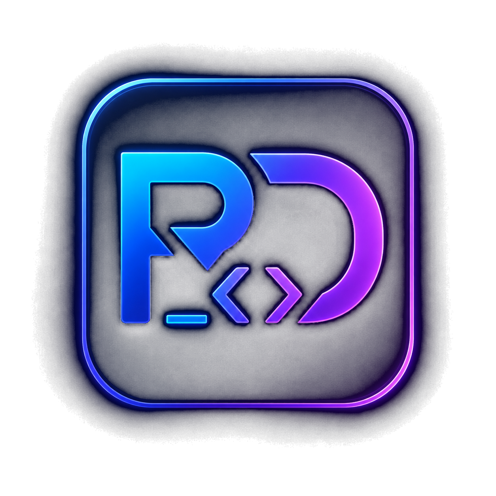

<div align="center">
  

  # RickDev Presence Studio

  **Crie, visualize e controle sua Discord Rich Presence em uma interface simples e personalizável.**

  <p>
    
    
    
  </p>
</div>

---

## Sobre o projeto

O **RickDev Presence Studio** é um aplicativo desktop para configurar uma Rich Presence personalizada no Discord sem precisar editar código.

Você pode definir textos, imagens, botões e tempo decorrido, acompanhar o resultado em uma pré-visualização e salvar até cinco perfis diferentes para alternar rapidamente entre suas configurações — e levá-los para outro computador com a exportação de perfis.

## Recursos

- Interface moderna com pré-visualização em tempo real;
- cinco perfis independentes, personalizáveis e salvos automaticamente;
- importação e exportação de perfis em arquivo JSON, para backup ou para usar em outro computador;
- tipo de atividade: Jogando, Ouvindo, Assistindo ou Competindo em;
- textos de detalhes e estado da atividade, com até quatro variações que se alternam sozinhas;
- imagem grande e imagem pequena, por chave de asset ou por link https, com textos ao passar o mouse;
- até dois botões com links externos;
- cronômetro opcional de tempo decorrido;
- modo de mídia: mostra a mídia em reprodução no Windows como atividade "Ouvindo", com barra de progresso, capa do álbum (opcional) e bloqueio por fonte;
- modo de alta prioridade com reaplicação automática e preservação do tempo decorrido;
- modo ausente: oculta a presence ou mostra outro perfil quando você se afasta do computador;
- inicialização minimizada com o Windows e ativação automática resiliente;
- reconexão automática quando o Discord fecha ou reinicia, mantendo o tempo decorrido;
- aviso de novas versões com notas da release publicadas no GitHub;
- conexão, atualização e desconexão da presence pela interface;
- funcionamento em segundo plano pela bandeja do sistema, com troca de perfil direto pelo menu do ícone;
- executável portátil para Windows, sem instalação.

## Primeiros passos

### 1. Crie um aplicativo no Discord

1. Acesse o [Discord Developer Portal](https://discord.com/developers/applications).
2. Clique em **New Application**, escolha um nome e confirme.
3. Na página **General Information**, copie o **Application ID**.
4. Cole o ID no campo **Application ID** do RickDev Presence Studio.

> O nome e o ícone configurados no Developer Portal identificam o aplicativo exibido na sua Rich Presence.

### 2. Adicione imagens

Há duas formas de usar imagens personalizadas:

- **Assets do Developer Portal:** abra seu aplicativo no Developer Portal, envie os arquivos na área de **Rich Presence Assets** e informe no Studio exatamente a chave definida para cada imagem. Elas podem levar alguns minutos para aparecer após o envio;
- **Link da imagem:** cole o endereço direto de uma imagem hospedada na internet, começando com `https://` (por exemplo, um link terminado em `.png`, `.jpg`, `.gif` ou `.webp`). Não é preciso enviar nada ao Developer Portal, e a pré-visualização mostra a imagem na hora.

Os campos são:

- **Imagem grande:** imagem principal da atividade;
- **Imagem pequena:** selo exibido sobre a imagem principal;
- **Texto da imagem:** mensagem mostrada ao passar o mouse.

### 3. Ative sua presence

1. Mantenha o aplicativo desktop do Discord aberto.
2. Preencha os campos desejados no Studio.
3. Confira o resultado na pré-visualização.
4. Clique em **Ativar presence**.

Após a conexão, você pode editar os campos e clicar em **Atualizar presence** para publicar as alterações.

## Tipo de atividade

O campo **Tipo de atividade** define o verbo que o Discord mostra antes do nome do aplicativo: **Jogando**, **Ouvindo**, **Assistindo** ou **Competindo em**. A pré-visualização acompanha a escolha. Se a versão do Discord não aceitar o tipo escolhido, a presence continua no ar como **Jogando**.

O modo de mídia sempre usa **Ouvindo** enquanto uma mídia toca; o tipo escolhido vale para a presence configurada do perfil.

## Textos que se alternam

Ligue **Alternar textos**, na seção **Textos**, para revezar os detalhes e o estado entre até quatro variações: a principal e mais três. Variações totalmente vazias são ignoradas, e o campo **Trocar a cada** define o intervalo, de 15 segundos a 5 minutos.

- A pré-visualização mostra qual texto está no ar (por exemplo, *Texto 2 de 3*) e pula para a variação que você estiver editando;
- o tempo decorrido não reinicia a cada troca;
- com o modo de mídia ligado, a troca só acontece enquanto a presence configurada estiver visível, sem interromper a música.

## Modo ausente

Nas **Preferências** (ícone de engrenagem), a seção **Ausente** decide o que acontece quando você se afasta do computador. Conta como ausente ficar sem usar o mouse e o teclado pelo tempo escolhido (de 5 minutos a 1 hora) ou bloquear a tela.

| Opção | O que acontece |
| --- | --- |
| Não mudar nada | A presence continua igual (padrão) |
| Ocultar a presence | A atividade some do Discord, mas a conexão continua aberta |
| Mostrar o perfil… | A presence passa a mostrar outro perfil, como um perfil "Ausente". Se ele não tiver Application ID, usa o do perfil ativo |

Ao voltar, a presence anterior é restaurada com o mesmo tempo decorrido. Enquanto o modo de mídia estiver mostrando uma mídia em reprodução, você não é considerado ausente. Clicar em **Atualizar presence** ou **Desconectar** encerra o estado de ausência na hora.

## Modo de mídia

A aba **Modo de mídia** concentra tudo do recurso: o interruptor de ativação (por perfil), a busca de capa e as fontes detectadas. Com ele ligado, a presence mostra sua mídia em reprodução no momento; enquanto nenhuma mídia estiver em execução, retoma a presence configurada do perfil. Funciona com Spotify, navegadores e qualquer player que se integre aos controles de mídia do Windows.

- A atividade aparece como **"Ouvindo"**, com título, artista e álbum da faixa;
- a barra de progresso acompanha a posição real da mídia, inclusive ao avançar ou voltar;
- a capa e o nome do álbum são buscados automaticamente no iTunes e, se ele não tiver a faixa, no Deezer; sem resultado, a imagem grande do perfil é usada (veja [Capa do álbum](#capa-do-álbum));
- os botões e a imagem pequena configurados no perfil continuam visíveis;
- ao pausar, a presence indica **"Em pausa"** e, após cerca de 30 segundos sem reprodução, volta sozinha para a presence configurada do perfil;
- a pré-visualização mostra em tempo real a mídia detectada antes mesmo de ativar a presence;
- trocas rápidas de faixa são agrupadas: o Discord aceita poucas atualizações de atividade em sequência, então o Studio espaça os envios (no mínimo 4 segundos entre eles) e sempre termina na faixa que está tocando.

### Capa do álbum

Para encontrar a capa, o Studio envia o título e o artista da faixa para a busca pública do iTunes, na loja da região do Windows. Se o iTunes não tiver a faixa, a mesma busca é feita no Deezer. Um resultado só é usado quando o artista e o título conferem com o que está tocando, para evitar a capa de outra música. Quando o player não informa o álbum, como acontece com navegadores, o nome do álbum encontrado também aparece na presence.

Títulos no formato do YouTube são limpos antes da busca: marcações como *(Clipe Oficial)* ou *[Áudio Oficial]* saem, canais terminados em *VEVO* ou *- Topic* viram o nome do artista e, em títulos como *Artista - Música*, o artista é lido do próprio título.

Se preferir não enviar essas informações, desligue **Buscar capa do álbum** na aba **Modo de mídia**: a presence passa a usar a imagem grande configurada no perfil. A opção vale para todos os perfis e, se a presence estiver ativa, a capa e o álbum encontrados saem do Discord na hora.

### Fontes

A lista de **Fontes** mostra os aplicativos reproduzindo mídia no Windows. Use **Bloquear** para que uma fonte nunca alimente o modo de mídia — se outra fonte desbloqueada estiver tocando (por exemplo, o Spotify), ela assume; sem nenhuma fonte desbloqueada, a presence configurada do perfil é aplicada. **Desbloquear** reverte a escolha a qualquer momento.

> **Navegadores:** cada navegador aparece como uma única fonte — o Windows não diferencia o que é vídeo ou música dentro dele. Para separar YouTube de YouTube Music, instale o YouTube Music como aplicativo (menu do navegador > *Instalar app*): ele vira uma fonte própria, e você pode bloquear o navegador sem perdê-lo.

> A detecção usa os controles de mídia do próprio Windows (Windows 10 1809 ou mais recente). Alguns players não informam duração; nesses casos a barra de progresso não é exibida.

## Perfis

O aplicativo possui cinco perfis independentes. Cada perfil guarda seu próprio Application ID, textos, imagens, botões e configuração do cronômetro.

- Clique em uma aba para carregar outro perfil;
- altere o campo **Nome do perfil** para identificá-lo;
- todas as mudanças são salvas automaticamente no computador;
- trocar de perfil não altera a presence ativa até você clicar em **Atualizar presence**.

### Perfis na bandeja

Clique com o botão direito no ícone do Studio na bandeja do Windows para trocar de perfil sem abrir a janela:

- a primeira linha mostra o que está no Discord agora, como "Discord: Programação";
- os cinco perfis aparecem pelo nome, com uma marca no que está ativo. Clicar em um deles aplica esse perfil na hora, como escolher a aba e clicar em **Atualizar presence**. Com a presence desligada, o clique já a ativa com esse perfil;
- **Desativar presence** desliga a presence, e **Ativar presence** liga com o perfil selecionado na janela;
- ao passar o mouse sobre o ícone, a dica mostra o perfil ativo e há quanto tempo ele está no ar.

Se o perfil escolhido tiver algum problema, como Application ID vazio ou link de imagem inválido, uma notificação do Windows explica o motivo e a presence atual continua como está. Escolher um perfil pela bandeja durante o modo ausente encerra a ausência. A janela acompanha a troca e abre na aba do perfil escolhido.

### Importar e exportar perfis

Use os botões abaixo das abas de perfis:

- **Exportar perfis** salva os cinco perfis em um arquivo `.json` (por padrão, `rickdev-presence-perfis.json` na pasta Documentos);
- **Importar perfis** abre um arquivo exportado e, depois de uma confirmação, substitui os cinco perfis atuais. Se o arquivo tiver menos de cinco perfis, os restantes ficam em branco.

A importação valida o arquivo: campos desconhecidos são descartados, textos longos são cortados no limite do Discord e arquivos inválidos são recusados com uma mensagem explicando o motivo. As preferências do aplicativo (inicialização, reconexão, fontes bloqueadas) não fazem parte do arquivo e continuam como estão. O próprio `presence-config.json` do Studio também pode ser importado.

## Preferências

O ícone de engrenagem, no canto superior direito, abre as **Preferências**, com as opções gerais do aplicativo. Se a inicialização com o Windows não puder ser configurada, a engrenagem ganha um ponto vermelho e o motivo aparece dentro do painel.

| Opção | O que faz |
| --- | --- |
| Iniciar com o Windows | Cria uma cópia gerenciada em `%LOCALAPPDATA%` e abre o Studio minimizado na bandeja ao entrar no Windows |
| Ativar presence ao iniciar | Ativa o perfil selecionado quando o Studio abre; se o Discord ainda não estiver pronto, tenta de novo em intervalos crescentes (15 s, 30 s e depois a cada 60 s) |
| Reconectar automaticamente | Se o Discord fechar ou reiniciar com a presence ativa, reconecta sozinho e reaplica a mesma presence, preservando o tempo decorrido. A primeira tentativa acontece após 5 s; enquanto o Discord estiver fechado, as tentativas seguem a cada 15 s, 30 s e depois 60 s. Clicar em **Desconectar** interrompe as tentativas. Ligada por padrão |
| Quando estiver ausente | O que fazer quando você se afasta: nada, ocultar a presence ou mostrar outro perfil (veja [Modo ausente](#modo-ausente)) |
| Considerar ausente após | Tempo sem usar o mouse e o teclado até contar como ausente: 5, 10, 15 ou 30 minutos, ou 1 hora |

## Campos disponíveis

| Campo | Descrição | Limite ou formato |
| --- | --- | --- |
| Application ID | Identificador do aplicativo criado no Discord | 17 a 20 números |
| Tipo de atividade | Verbo mostrado antes do nome do app | Jogando, Ouvindo, Assistindo ou Competindo em |
| Detalhes | Texto principal da atividade | Até 128 caracteres |
| Estado | Texto complementar da atividade | Até 128 caracteres |
| Alternar textos | Reveza detalhes e estado entre até quatro variações | Ligado ou desligado |
| Detalhes e Estado 2 a 4 | Variações usadas quando os textos se alternam | Até 128 caracteres cada |
| Trocar a cada | Intervalo entre as variações | 15 s, 30 s, 1 min, 2 min ou 5 min |
| Imagem grande | Chave do asset principal ou link da imagem | Chave de um asset existente ou link `https://` |
| Texto da imagem grande | Texto exibido ao passar o mouse | Até 128 caracteres |
| Imagem pequena | Chave do asset secundário ou link da imagem | Chave de um asset existente ou link `https://` |
| Texto da imagem pequena | Texto exibido ao passar o mouse | Até 128 caracteres |
| Botão 1 e Botão 2 | Texto dos botões da activity | Até 32 caracteres |
| URL dos botões | Endereço aberto ao clicar no botão | URL válida |
| Mostrar tempo decorrido | Exibe o tempo desde a ativação | Ligado ou desligado |
| Alta prioridade | Reaplica a presence a cada 60 segundos sem reiniciar o tempo | Ligado ou desligado |
| Modo de mídia | Substitui os textos pela mídia em reprodução no Windows | Ligado ou desligado |

> Para cada botão, preencha o texto e a URL juntos. O Discord pode não mostrar os botões para você na sua própria activity; teste visualizando seu perfil por outra conta.

## Executando o aplicativo

### Executável portátil

Baixe o arquivo `RickDev Presence Studio.exe` na página de [Releases](https://github.com/Eu-RickDev/RickDev-presence-studio/releases/latest) e execute-o. Não é preciso instalar nada.

Se você gerou o executável localmente (veja abaixo), ele fica em `dist/RickDev Presence Studio.exe`.

Ao fechar a janela, o aplicativo continua ativo na bandeja do sistema para manter a presence conectada. Pelo mesmo ícone dá para trocar de perfil ou desativar a presence (veja [Perfis na bandeja](#perfis-na-bandeja)). Para encerrá-lo completamente, clique com o botão direito no ícone da bandeja e selecione **Encerrar**.

Ao habilitar **Iniciar com o Windows**, o Studio cria uma cópia gerenciada em `%LOCALAPPDATA%\RickDev Presence Studio`. O Windows usa essa cópia estável, portanto mover ou renomear o executável baixado não interrompe a inicialização automática. Para atualizar essa cópia, encerre a versão anterior pela bandeja e abra o novo executável; a substituição ocorre antes de o registro de inicialização ser renovado.

### Ambiente de desenvolvimento

Pré-requisitos:

- [Node.js](https://nodejs.org/) 18 ou mais recente;
- npm;
- Discord desktop instalado e aberto.

Clone o repositório, instale as dependências e inicie o projeto:

```powershell
npm install
npm start
```

Para gerar um novo executável portátil do Windows:

```powershell
npm run build
```

O arquivo gerado será salvo na pasta `dist`.

## Scripts

| Comando | Ação |
| --- | --- |
| `npm start` | Inicia o aplicativo |
| `npm run dev` | Inicia o aplicativo em ambiente de desenvolvimento |
| `npm run build` | Gera o executável portátil para Windows |

## Estrutura do projeto

```text
.
├── build/                  # Ícones usados pelo aplicativo e pelo build
├── dist/                   # Executável portátil gerado por npm run build (não versionado)
├── src/
│   ├── renderer/           # Interface, estilos e comportamento da tela
│   ├── main.js             # Janela, bandeja, conexão com o Discord, reconexão e IPC
│   ├── config.js           # Perfis e preferências: validação, gravação segura, importação e exportação
│   ├── activity.js         # Montagem da atividade: tipo, textos alternados, imagens e botões
│   ├── media.js            # Detecção de mídia do Windows e montagem da atividade "Ouvindo"
│   ├── artwork.js          # Busca da capa e do álbum no iTunes e no Deezer
│   ├── tray.js             # Menu e dica do ícone da bandeja
│   ├── startup.js          # Inicialização com o Windows pela cópia gerenciada
│   ├── version.js          # Comparação de versões para o aviso de atualização
│   └── preload.js          # Comunicação segura entre interface e processo principal
├── package.json
└── README.md
```

## Solução de problemas

### A presence não conecta

- **"Discord não encontrado"**: o Discord desktop não está aberto (a versão web não serve). Abra o aplicativo e tente de novo;
- **"O Discord encerrou a conexão"**: geralmente o Application ID não existe ou foi copiado errado. Confira se ele possui somente números e corresponde ao aplicativo do Developer Portal;
- **"O Discord recusou a presence"**: algum campo foi rejeitado pelo Discord. Se a presence já estava ativa, ela continua no ar sem alterações; ajuste o campo indicado e clique em **Atualizar presence**;
- reinicie o Discord caso a conexão RPC não esteja disponível.

### A presence sumiu depois que o Discord reiniciou

Com **Reconectar automaticamente** ligado, o Studio reaplica a presence sozinho assim que o Discord volta, e o status mostra as tentativas. Se a opção estiver desligada, clique em **Ativar presence** novamente.

### Meus perfis voltaram ao padrão

Se o arquivo de configuração for corrompido (por exemplo, por um desligamento no meio da gravação), o Studio avisa ao abrir e guarda o arquivo original como `presence-config.corrompido-<data>.json`, na mesma pasta de dados do aplicativo (em `%APPDATA%`), para que nada seja perdido. As gravações são feitas em um arquivo temporário e trocadas de uma vez, o que evita esse problema. Para ter um backup próprio, use **Exportar perfis**.

### As imagens não aparecem

- Confirme que as chaves informadas são exatamente iguais às cadastradas no Developer Portal;
- aguarde alguns minutos após enviar novos assets;
- verifique se os assets pertencem ao mesmo aplicativo do Application ID usado;
- se usar um link, ele precisa começar com `https://` e apontar direto para o arquivo da imagem, não para uma página que a exibe.

### Os botões não aparecem

- Preencha o texto e a URL do botão;
- use uma URL válida iniciada por `http://` ou `https://`;
- visualize seu perfil usando outra conta do Discord para testar.

---

<div align="center">
  Feito com Electron e Discord RPC.
</div>
